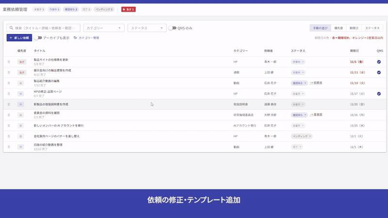
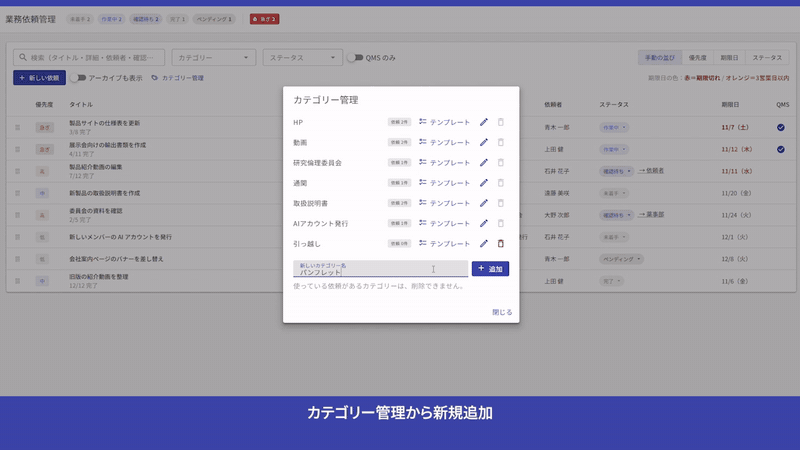

# BizRequestTracker

**他部署から届く制作依頼を、表と詳細モーダルで管理する、社内向けの依頼管理アプリ。**
業務フローを「テンプレート」として登録しておき、**ワンクリックで、依頼のチェックリストに入れられる**のが、いちばんの特徴です。

通関書類、HP、取扱説明書、動画など、依頼の種類ごとに、決まった作業の流れがある業務を想定しています。使う人は1人で、ログインはありません。
AIエンジニア養成コースの課題として作った、個人開発のアプリです（バックエンド：Python・FastAPI、画面：Vue 3・TypeScript）。

## 画面の動き



「テンプレートを入れる」を1回押すと、業務フローのチェックリストが並びます。チェックを付けると、進み具合が、一覧に出ます。

**主な機能の操作が、ひと通り分かる動画**（2分37秒）

https://github.com/user-attachments/assets/9fe7076b-039f-43d7-9ca7-7068107d59fc

新しい依頼の登録 → テンプレート → チェック → 並び替え → ステータス変更 → アーカイブ → 完全な削除。

テンプレートの元になる、カテゴリーの追加と、作業項目の登録は、「カテゴリー管理」から行います。



**カテゴリー管理とテンプレート編集の動画**（1分37秒）

https://github.com/user-attachments/assets/ee15cb81-e3d0-46d4-8ed4-0f9f00f5485e

カテゴリーの追加 → テンプレートの項目の追加 → 保存 → 新しい依頼にテンプレートを入れる → 絞り込み・検索。

画面に映っているデータは、すべて架空のサンプルです。

## 特徴

### 業務フローを「テンプレート」にして、ワンクリックで使える
- 業務カテゴリー（HP、動画、通関、取扱説明書など）ごとに、**作業項目のひな形（テンプレート）**を、事前に登録しておけます。7つの業務のテンプレートが、最初から入っています。
- 依頼を開いて「**テンプレートを入れる**」を1回押すと、その業務の作業項目が、**チェックリスト**として並びます。たとえば「動画」なら、企画の打ち合わせ → 絵コンテ作成 → … → 書き出し・チェック → 納品、の12項目です。もう一度押しても、同じ項目は、重なりません。
- チェックを付けると、一覧のタイトルの下に、**進み具合**（例：3/6 完了）が出ます。依頼ごとに、項目を足すこともできます（テンプレートは、変わりません）。
- テンプレートとカテゴリーは、**画面から、自分で管理**できます（追加・名前の変更・削除。使っている依頼があるカテゴリーは、削除できません）。コードを触らずに、業務の変化に合わせられます。

### 依頼を、一覧で、ひと目で管理する
- **期限の色分けは、営業日で数えます。** 土日・日本の祝日・会社の休みを除いて、3営業日以内はオレンジ、期限切れは赤。完了・ペンディング・アーカイブ中の依頼には、色を付けません。
- **検索・絞り込み・並び替え**：タイトル・詳細・依頼者・確認先で検索。QMS・カテゴリー・ステータスで絞り込み。優先度・期限日・ステータス・**手動の並び**で並び替え。手動の並びは、ドラッグで変えて、保存されます。
- **一覧から、ステータスを直接変更**できます。「確認待ち」にすると、確認先を入力します（過去に入れた確認先が、候補に出ます）。画面上部には、ステータス別の件数と、「急ぎ」の件数が出ます。
- **アーカイブと、完全な削除を、分けています。** ふだんは、消さずにアーカイブして残します。完全に削除できるのは、アーカイブ中の依頼だけ（確認つき）。

### 誰でも使えるように
- Tab キーだけで、操作できます。モーダルやボタンには、読み上げソフト向けの名前を付けています（自動のアクセシビリティ検査つき）。

## 使っている技術

| 分野 | 技術 |
|---|---|
| バックエンド | Python 3.13、FastAPI、SQLAlchemy、Alembic（DB の変更の記録）、uv（部品の管理） |
| データベース | MySQL 8.4（Docker） |
| 画面 | Vue 3、TypeScript、Vuetify（部品集）、Vite、vue-draggable-plus（ドラッグ） |
| テスト・検査 | pytest、Vitest、Vue Test Utils、axe-core（アクセシビリティ）、ruff、ESLint、Prettier |
| 自動化 | GitHub Actions（CI） |

選んだ理由と、1本目のアプリ（TaskManagement）との比較は、[技術スタック](docs/tech-stack.md)に書いています。

## 作り方の特徴

- **順番を決めて、1つずつ進めました。** 要件定義（機能・画面・非機能・受け入れ条件）→ 画面のプロトタイプ → API 設計 → API → 画面 → 品質チェック。決めたことは、すべて文書に残しています（[文書](#文書)）。
- **すべての変更を、Issue → ブランチ → Pull Request の流れで、入れています。** 小さな修正も、例外なしです。
- **品質を、仕組みで守っています。**
  - 自動テスト（バックエンド・画面）と、カバレッジの計測
  - アクセシビリティの自動検査
  - CI（GitHub Actions）：PR のたびに、テスト・静的チェック・整形の確認・ビルドを、自動で実行
  - `main` ブランチの保護：CI が通らないと、マージできない
  - 完成後に、全体を点検して、指摘を記録し、直しました（[品質チェックの記録](docs/quality-review.md)）
- **学んだことを、記録しています。** 作りながら気づいたこと・つまずいたことを、[学習ノート](notes/README.md)に残しています。
- **Claude Code（AI のコーディング支援）と、対話しながら進めました。** 作業は AI が進め、内容の確認と、機能・技術の決定は、私が行いました。
- **公開リポジトリとして、配慮しています。** サンプルデータは、すべて架空です。パスワードなどの秘密情報は、コミットしていません。

## AWS へのデプロイ（実施済み）

2026年11月10日に、AWS（東京リージョン）へ、実際に置いて動かしました。構成は、EC2（サーバー）と RDS（MySQL 8.4。外からは入れない場所）です。

- **入れ物（ネットワーク・サーバー・データベース）は、Terraform で作りました。** 段階ごとに、`plan`（作る前の答え合わせ）を読んでから、`apply` しました。入口は、自分の IP だけに絞っています。
- **アプリは、画面をビルドして、1つのファイルにまとめて送り、サーバーの中で動かしました**（nginx と systemd）。
- ブラウザで、一覧・カテゴリー・依頼の保存まで、動くことを確かめて、録画しました。
- **録画のあと、`terraform destroy` で、すべて消しました。** AWS に残っている物は、ありません（費用がかかるのは、動かしている間だけです）。

構成は [AWS の構成](docs/infrastructure.md)、当日の手順は [デプロイの手順書](deploy/README.md)、学んだことは [学習ノート](notes/README.md) にあります。

## これから

- 将来の候補：詳細モーダルのカレンダーでの、土日祝日の色分け。テンプレートの項目を、途中に挿入する機能（[機能一覧](docs/functional-requirements.md)の「将来の候補」）

## 動かし方

前提：[uv](https://docs.astral.sh/uv/)、Docker Desktop、Node.js が入っていること。

### 1. データベース（MySQL）

```
# .env.example を .env にコピーして、パスワードを決めてから（.env は、コミットしません）
docker compose up -d db
```

### 2. バックエンド（API）

```
cd backend
uv sync
uv run alembic upgrade head   # 表を作る＋初期データ（7つのカテゴリーとテンプレート）を入れる（初回と、マイグレーションが増えたとき）
uv run uvicorn app.main:app --port 8000
# 確認： http://127.0.0.1:8000/health  →  {"status":"ok"}
# API の一覧と試し打ち： http://127.0.0.1:8000/docs（FastAPI が自動で作る説明画面）
```

### 3. 画面

先に、上の手順で、API を起動しておきます。

```
cd frontend
npm install
npm run dev     # http://localhost:5173 を開く（ポートは固定）
```

開発用サーバーは、画面から呼ぶ `/api` と `/health` を、API（8000番）に中継します。

### テスト・静的チェック

```
# バックエンド（backend/ で。MySQL の起動が必要）
uv run pytest
uv run pytest --cov   # テストと、カバレッジ（テストが通った範囲）の測定。しきい値を下回ると失敗する
uv run ruff check .
uv run ruff format --check .

# 画面（frontend/ で。PowerShell では npm.cmd）
npm run test
npm run test:coverage   # テストと、カバレッジの測定。しきい値を下回ると失敗する
npm run lint
npm run format:check    # 整形の確認（書き換えない）。直すときは npm run format
npm run build           # 型チェックとビルド
```

PR を作ると、GitHub Actions（[`.github/workflows/ci.yml`](.github/workflows/ci.yml)）が、これらを自動で行います。結果は、PR の「Checks」で見られます。

`prototype/` は、画面の見た目を確かめた、使い捨ての試作です（API にはつなぎません）。

## 文書

- [要件定義](docs/requirements.md)（入口。機能一覧・ユースケース・画面設計・非機能要件・受け入れ条件へ）
- [機能一覧](docs/functional-requirements.md)
- [ユースケース](docs/use-cases.md)
- [画面設計](docs/screen-design.md)
- [データ設計](docs/data-model.md)
- [API 設計](docs/api-design.md)
- [非機能要件](docs/non-functional-requirements.md)
- [技術スタック](docs/tech-stack.md)
- [品質チェックの記録](docs/quality-review.md)
- [画面のプロトタイプ](prototype/README.md)
- [学習ノート](notes/README.md)

素材（フォント・アイコン）の出典とライセンスは、[CREDITS.md](CREDITS.md) に書いています。
