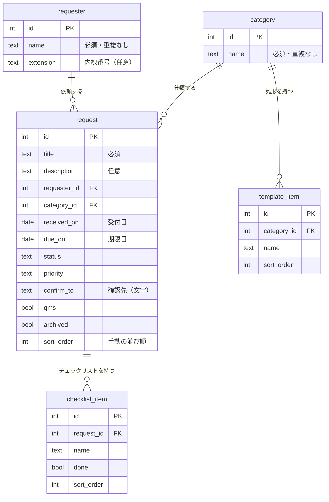

# データ設計

DB（MySQL）に作る表の設計。要件は [requirements.md](requirements.md) を参照。
決まっていないことが出たら、ユーザーに確認してから、この文書を更新する。

## 1. 表と関係の図

## 2. 表ごとの項目

### request（依頼）
| 項目 | 型 | 必須 | 初期値・制約 |
|---|---|---|---|
| id | 整数 | ○ | 自動で振る（主キー） |
| title | 文字 | ○ | |
| description | 長い文字 | | |
| requester_id | 整数 | ○ | requester への参照 |
| category_id | 整数 | ○ | category への参照 |
| received_on | 日付 | ○ | 初期値は今日 |
| due_on | 日付 | ○ | |
| status | 文字 | ○ | 初期値は `未着手`。次の5つのどれか：未着手・作業中・確認待ち・完了・ペンディング |
| priority | 文字 | ○ | 初期値は `中`。次の4つのどれか：急ぎ・高・中・低 |
| confirm_to | 文字 | | 確認先。「確認待ち」でなくなっても**消さずに残す**（画面で隠す） |
| qms | 真偽 | ○ | 初期値は オフ |
| archived | 真偽 | ○ | 初期値は オフ |
| sort_order | 整数 | ○ | 手動の並び順。新しい依頼は、いちばん上になる値を入れる |

### requester（依頼者）
| 項目 | 型 | 必須 | 制約 |
|---|---|---|---|
| id | 整数 | ○ | 主キー |
| name | 文字 | ○ | 重複なし |
| extension | 文字 | | 内線番号。先頭の 0 などを守るため、数字ではなく**文字**で持つ |

- 削除する機能は作らない（依頼が使っているため）。名前と内線番号の変更はできる

### category（業務カテゴリー）
| 項目 | 型 | 必須 | 制約 |
|---|---|---|---|
| id | 整数 | ○ | 主キー |
| name | 文字 | ○ | 重複なし |

- 依頼が1件でも使っているカテゴリーは、削除できない。使っていないものだけ削除できる
- 削除すると、そのカテゴリーのテンプレート項目も一緒に消える

### template_item（テンプレート項目）
| 項目 | 型 | 必須 | 制約 |
|---|---|---|---|
| id | 整数 | ○ | 主キー |
| category_id | 整数 | ○ | category への参照 |
| name | 文字 | ○ | 項目名 |
| sort_order | 整数 | ○ | カテゴリーの中での順番 |

### checklist_item（チェック項目）
| 項目 | 型 | 必須 | 制約 |
|---|---|---|---|
| id | 整数 | ○ | 主キー |
| request_id | 整数 | ○ | request への参照。依頼を削除すると、一緒に消える |
| name | 文字 | ○ | 項目名 |
| done | 真偽 | ○ | 初期値は オフ（チェックなし） |
| sort_order | 整数 | ○ | 依頼の中での順番 |

## 3. 決めごと
- **テンプレートを入れるとき**は、テンプレート項目を**コピー**して、チェック項目を作る。あとでテンプレートを直しても、すでにある依頼のチェックリストは変わらない
- **確認先**は、表にしない。依頼の欄に文字で持ち、過去に使った文字を候補に出す
- **一覧の進み具合**（例：3/6 完了）は、チェック項目の数と、`done` の数から、その都度計算する（保存しない）
- **期限の色分け**は、期限日・ステータス・アーカイブから、その都度計算する（保存しない）。営業日の計算は、要件定義の「期限の色分け」のとおり（土日祝と会社の休みを除く）
- **並び替え（優先度・期限日・ステータス）**は、見せ方だけ。`sort_order` は変えない
- ステータスと優先度は、DBには文字で持つ。許される値の確認は、API の入口でも行う
