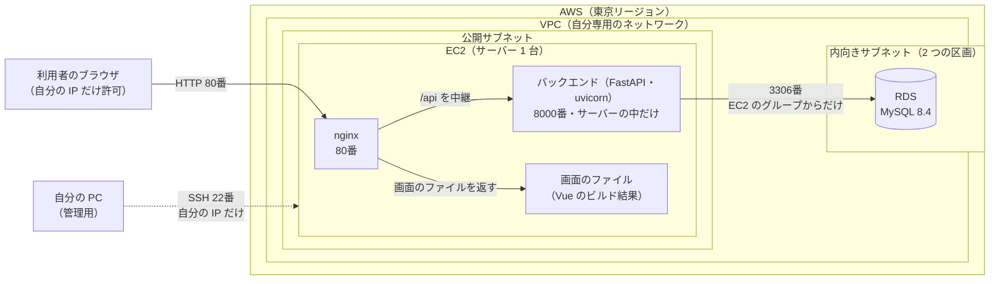

# AWS の構成（インフラ構成）

このアプリを、AWS に置いて動かすときの構成を説明する。コードは [terraform/](../terraform/)（AWS に作る物）にある。サーバーの中の設定（`deploy/`）は、別の PR で追加する。

> **位置づけ**：このアプリは、本来は、利用者の PC の中だけで動かす（[非機能要件](non-functional-requirements.md)）。AWS への配置は、**学習と動作確認のためのもの**で、使い終わったら `terraform destroy` で全部消す。AWS 上には、普段は何も置いていない。1本目のアプリ（TaskManagement）と、ほぼ同じ構成。
>
> **細かい設定値**（IP の範囲、型、容量、バージョンなど）は、変わりやすいので、ここには書かない。値は [terraform/variables.tf](../terraform/variables.tf) と、各 `.tf` ファイルを見る。

## 1. 全体の構成図



- ブラウザが話す相手は、**80番の nginx だけ**。バックエンドは、サーバーの中の `127.0.0.1:8000` だけで待ち受け、外には出ない。
- nginx は、画面のファイルを返し、`/api` で始まるお願いを、バックエンドへ中継する。ブラウザからは「同じ場所との通信」に見えるので、CORS（別の場所との通信を止める、ブラウザの安全機能）の設定は要らない。
- **API の説明画面（`/docs`）は、外に出さない。** nginx が中継するのは `/api/` だけで、それ以外の場所（`/docs` など）は、画面のファイル（`index.html`）が返るだけ。
- RDS には、インターネットへの道がない。EC2 からしか、つながらない。

## 2. 作る物の一覧と役割

| まとまり | 作る物 | 役割 | コード |
|---|---|---|---|
| ネットワーク | VPC、公開サブネット 1、内向きサブネット 2、インターネットゲートウェイ、経路表 | 自分専用のネットワーク。EC2 を置く区画（外とつながる）と、RDS を置く区画（外とつながらない）に分ける | [vpc.tf](../terraform/vpc.tf) |
| 通信の許可 | セキュリティグループ 2 つ（EC2 用、RDS 用）と、その入口・出口のルール | 書いていない通信は、すべて拒否。入口は下の表のとおり | [security_groups.tf](../terraform/security_groups.tf) |
| サーバー | SSH 用の公開鍵の登録、EC2 | アプリを動かすサーバー。起動時に、nginx と uv（Python の管理の道具）を自動で入れる | [ec2.tf](../terraform/ec2.tf)、[user_data.sh](../terraform/user_data.sh) |
| データベース | DB サブネットグループ、RDS（MySQL） | アプリのデータの保存先。AWS が管理する。**`create_database` が true のときだけ作る** | [rds.tf](../terraform/rds.tf) |
| 設定と出力 | Terraform と AWS の版、地域、共通のタグ、変数、作成後に表示する値 | 全体の共通設定 | [main.tf](../terraform/main.tf)、[variables.tf](../terraform/variables.tf)、[outputs.tf](../terraform/outputs.tf) |

### 通信の許可（入口）

| 入口 | 送信元 | 目的 |
|---|---|---|
| EC2：22番（SSH） | 自分の IP の 1 台だけ | サーバーの操作・ファイルの転送 |
| EC2：80番（HTTP） | 自分の IP の 1 台だけ | ブラウザでアプリを開く |
| RDS：3306番（MySQL） | EC2 のセキュリティグループに属する物だけ | バックエンドが、DB につなぐ |

- 8000番（バックエンド）は、開けていない。
- `0.0.0.0/0`（全世界）を、入口に書かない（変数の検証でも、弾いている）。
- 出口は、EC2 は全部許可（ソフトの導入のため）。RDS は、出口のルールなし。

## 3. 設計の方針

| 方針 | 理由 |
|---|---|
| 画面とバックエンドを、同じ EC2 に載せる | 構成が単純で、1本目と同じ。費用も小さい |
| 画面と API を、nginx で、同じ入口に見せる | CORS の設定が要らない。`/docs` などを、外に出さない（B5 の決定） |
| 入口は、自分の IP だけ | このアプリには、ログインがない。誰でも、依頼を作ったり、消したりできてしまうため、不特定多数には見せない |
| HTTPS は、今回はしない | 入口が、自分の IP だけで、短い時間しか動かさないため。公開するなら、ドメインを取って HTTPS にする（6 を参照） |
| RDS は、公開しない。EC2 のグループからだけ許可 | 外から直接つなげない。EC2 の IP が変わっても、そのまま使える |
| RDS は開発環境向け（1 台だけ、自動バックアップなし、消すときの記録も残さない、版が勝手に上がらない） | すぐ消せることと、費用を優先。Multi-AZ（有料）は使わない |
| NAT Gateway は作らない | 置いておくだけで、毎月お金がかかるため |
| ディスクと RDS は暗号化。EC2 のメタデータは、合言葉つき（IMDSv2）にする | AWS の推奨設定 |
| 作る物すべてに、同じタグ（`Project`、`ManagedBy`）を付ける | AWS の画面で、何のための物かが分かる。費用の確認にも使える |
| 秘密（DB のパスワード、IP）は、コードに書かず、`terraform.tfvars`（コミットしない）に書く | 公開リポジトリのため |
| 段階ごとに作って確認する（RDS は、スイッチで切り替え） | うまくいかないとき、どこが原因か、分かりやすい。確認のたびに消さずに、足していく |
| 使い終わったら、`terraform destroy` で消す | 費用が、かからないようにする |

## 4. アプリの置き方（EC2 の中。次の PR で、設定ファイルを `deploy/` に追加する）

手元で作った成果物を、EC2 に送って置く。EC2 は、メモリが少ないので、画面のビルドは、手元で行う。

| 置く物 | EC2 の中の場所（予定） | もとになる物 |
|---|---|---|
| バックエンド | `/opt/bizrequesttracker/backend/` | `backend/`（`.venv` と、テストは、送らない）。`uv sync` で、Python 3.13 と部品を入れる |
| 画面のファイル | nginx の公開フォルダ | `frontend/` を `npm run build` でビルド（`dist`） |
| バックエンドの常駐の設定（systemd） | `/etc/systemd/system/` | `deploy/`（次の PR） |
| nginx の設定（中継と、画面の配信） | `/etc/nginx/default.d/` | `deploy/`（次の PR） |
| DB の接続情報（環境変数 `DATABASE_URL`） | `/etc/bizrequesttracker.env`（管理者だけが読める） | リポジトリには置かない。RDS の接続先とパスワードが入る |

- DB の接続先は、**環境変数 `DATABASE_URL` で RDS に向ける**。アプリのコードは、変えない（もともと、この環境変数を優先する作り）。
- 表と初期データ（7つのカテゴリーとテンプレート）は、`uv run alembic upgrade head` で、RDS に作る。

## 5. ディレクトリ構成（AWS に関わる部分）

```
BizRequestTracker/
├─ terraform/                  AWS に作る物のコード（Terraform）
│  ├─ main.tf                  Terraform と AWS の版、地域、共通のタグ
│  ├─ variables.tf             外から渡せる設定値（IP、型、DB の名前、スイッチなど）
│  ├─ vpc.tf                   ネットワーク
│  ├─ security_groups.tf       通信の許可
│  ├─ ec2.tf                   サーバー
│  ├─ user_data.sh             サーバーの起動時に、1回だけ実行する命令（道具の導入）
│  ├─ rds.tf                   データベース
│  ├─ outputs.tf               作成後に表示する値（IP、接続先など）
│  └─ terraform.tfvars         自分の値（コミットしない。見本は terraform.tfvars.example）
├─ deploy/                     サーバーの中に置く設定ファイル（次の PR で追加）
└─ docs/infrastructure.md      この文書
```

使い方（コマンド）は、[terraform/README.md](../terraform/README.md)。

## 6. 公開するときの課題（今回はやっていない）
- **ログインがない**ので、他の人に見せるなら、先に、認証などの対策が要る。
- 今は `http://`（暗号化なし）。公開するなら、ドメイン名を取って、HTTPS にする。
- 費用がかからない構成のため、冗長化（複数台、Multi-AZ）や、自動バックアップはしていない。
- GitHub Actions からの自動デプロイ（OIDC）は、必要になったときに考える。

技術の決定は、[tech-stack.md](tech-stack.md)。
